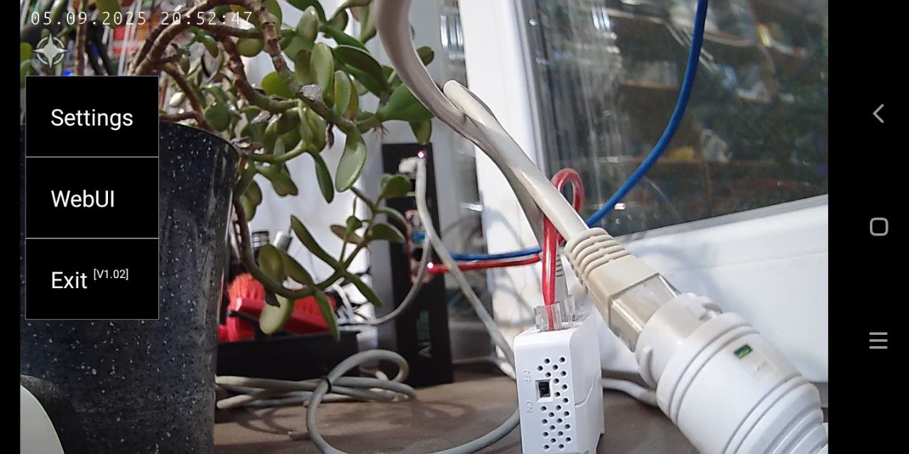

<picture>
  <source media="(prefers-color-scheme: dark)" srcset="https://openipc.org/assets/openipc-logo-white.svg">
  <source media="(prefers-color-scheme: light)" srcset="https://openipc.org/assets/openipc-logo-black.svg">
  
</picture>

# OpenIPC Decoder

[English](README.md) | **Русский** | [简体中文](README.zh-CN.md)

[](https://github.com/OpenIPC/decoder/actions/workflows/build.yml)
[](https://github.com/OpenIPC/decoder/releases/tag/latest)
[](LICENSE.md)
[](https://developer.android.com/about/versions/lollipop)

Компактное приложение для Android: показывает RTSP-потоки с IP-камер и декодирует H.264/H.265 аппаратно. Создано для камер с прошивкой [OpenIPC](https://openipc.org). Работает на телефонах, планшетах, телевизорах, ТВ-приставках и автомобильных устройствах.

<p align="center">
  
</p>

## Скачать

Готовые сборки лежат в [релизе **latest**](https://github.com/OpenIPC/decoder/releases/tag/latest):

| Файл             | Что это                                            |
|------------------|----------------------------------------------------|
| `decoder-v2.apk` | **Текущая версия**, рекомендуется                  |
| `decoder.apk`    | Старая версия из ветки `basic`                     |
| `*.aab`          | Пакеты для Google Play; вручную не устанавливаются |

Есть бета-канал в [Google Play](https://play.google.com/apps/internaltest/4701231141824898735). Чтобы попасть в него, пришлите свой e-mail через [Telegram-каналы OpenIPC](https://openipc.org/our-channels).

## Возможности

- **Видео:** воспроизведение RTSP, аппаратное декодирование H.264/H.265 через MediaCodec
- **Звук:** AAC (RFC 3640 `mpeg4-generic`, ADTS), G.711 μ-law/A-law, L16 PCM (моно и стерео)
- **Режимы:** одна камера или Quad — 4 камеры на одном экране
- **Управление:** масштаб двумя пальцами, перемещение, сброс двойным касанием, пульт Android TV (Leanback)
- **Сеть:** автоматическое переподключение с растущей задержкой, индикатор качества связи
- **WebUI:** встроенный браузер для веб-интерфейса камеры
- **Прочее:** скриншот долгим нажатием, 4 слота для камер, приём ссылок из других приложений

## Требования

- Android 5.0 (API 21) или новее
- IP-камера с RTSP поверх TCP (см. [Известные ограничения](#известные-ограничения))

## Быстрый старт

1. Установите APK из [релиза latest](https://github.com/OpenIPC/decoder/releases/tag/latest) и запустите приложение.
2. Коснитесь экрана или нажмите **OK** на пульте, чтобы открыть меню.
3. Выберите номер камеры (**1**–**4**), нажмите **Settings** и введите адрес камеры:
   ```
   rtsp://username:password@ip_address:554/stream=0
   ```
4. Нажмите **Save**. Приложение сразу подключится и само переподключится, если поток прервётся.

## Управление

### Меню

| Пункт        | Действие                                                                                                                                                                                       |
|--------------|------------------------------------------------------------------------------------------------------------------------------------------------------------------------------------------------|
| **Q**        | Включить или выключить режим Quad                                                                                                                                                              |
| **1**–**4**  | Переключиться на слот камеры. Цвет номера активного слота показывает качество связи: зелёный — джиттер меньше 100 мс, жёлтый — 100–300 мс, красный — больше 300 мс. Серый номер — пустой слот. |
| **Settings** | Изменить RTSP-адрес активного слота (только в режиме одной камеры)                                                                                                                             |
| **WebUI**    | Открыть веб-интерфейс камеры; логин и пароль берутся из RTSP-адреса (только в режиме одной камеры)                                                                                             |
| **Exit**     | Закрыть приложение. Мелкий текст рядом — версия приложения и хеш сборки.                                                                                                                       |

### Жесты и кнопки

| Ввод                         | Действие                                |
|------------------------------|-----------------------------------------|
| Касание / **OK** / **Enter** | Открыть или закрыть меню                |
| **Back** / **Esc**           | Закрыть меню                            |
| Щипок, затем перетаскивание  | Увеличение (до 5×) и перемещение        |
| Двойное касание              | Сбросить масштаб                        |
| Долгое нажатие               | Сохранить скриншот в `Pictures/OpenIPC` |

### Открытие камеры из другого приложения

Приложение принимает текст через «Поделиться» (`ACTION_SEND`, `text/plain`). Если поделиться ссылкой `rtsp://` из другого приложения, например из OpenIPC Network, она запишется в активный слот.

### Режим Quad

Показывает все настроенные слоты сеткой 2×2. У каждой ячейки своё подключение и свой декодер. Звук в этом режиме выключен. Коснитесь любой ячейки, чтобы открыть меню.

## Известные ограничения

> [!IMPORTANT]
> Это известные пробелы, которые мы планируем закрыть. На каждый заведён issue — комментарии, результаты проверок и pull request приветствуются.
>
> - **Только RTSP поверх TCP.** UDP и multicast не поддерживаются — [#7](https://github.com/OpenIPC/decoder/issues/7)
> - **Только Basic-авторизация.** Камеры, которым нужен Digest, не подключатся — [#8](https://github.com/OpenIPC/decoder/issues/8)
> - **Кодек видео определяется по номеру payload type** (96 = H.264, 97 = H.265), а не по SDP. H.265 на PT 96 не воспроизводится — [#9](https://github.com/OpenIPC/decoder/issues/9)
> - **Упрощённая обработка RTP для видео:** нет агрегации STAP-A/AP, пакеты с CSRC или расширением заголовка отбрасываются, потери пакетов не обрабатываются — [#10](https://github.com/OpenIPC/decoder/issues/10)
> - **Нет RTSP keepalive.** Серверы с таймаутом сессии могут периодически обрывать поток — [#11](https://github.com/OpenIPC/decoder/issues/11)
> - **В режиме Quad нет звука** — [#12](https://github.com/OpenIPC/decoder/issues/12)
> - **Только 4 слота для камер** — [#13](https://github.com/OpenIPC/decoder/issues/13)
> - **Не поддерживаются форматы звука** MP4A-LATM, Opus, G.726, а также AAC-кадры, разбитые на несколько RTP-пакетов — [#14](https://github.com/OpenIPC/decoder/issues/14)
> - **Возможная зависимость от сервисов Google (GAPPS)** на некоторых устройствах; изучается, поэтому отключайте GAPPS осознанно — [#15](https://github.com/OpenIPC/decoder/issues/15)
> - **Логин и пароль хранятся и передаются в открытом виде** (RTSP/HTTP без шифрования, Basic-авторизация) — [#16](https://github.com/OpenIPC/decoder/issues/16)
>
> Известные ошибки собраны отдельно, под [меткой `bug`](https://github.com/OpenIPC/decoder/issues?q=is%3Aissue+is%3Aopen+label%3Abug).

## Ветки

| Ветка   | Назначение                                                                                                            |
|---------|-----------------------------------------------------------------------------------------------------------------------|
| `v2`    | **Основная ветка разработки** (по умолчанию). Модульный код в `android/`. Сборки публикуются как `decoder-v2.apk`.    |
| `basic` | Старая версия 1.0x в одном файле, сохранена для справки и для старых установок. Сборки публикуются как `decoder.apk`. |

Pull request делайте от ветки `v2`.

## Сборка

Нужны JDK 17 и Android SDK (platform 36). Путь к SDK задаётся через `ANDROID_HOME` или `android/local.properties`.

```bash
cd android
./gradlew assembleDebug        # отладочная сборка, ключи подписи не нужны
# → app/build/outputs/apk/debug/app-debug.apk
```

Для релизной сборки нужно хранилище ключей `android/key.jks` и переменные окружения:

```bash
export KEYSTORE_PASS=your_password
export KEY_ALIAS=your_alias
export KEY_PASS=your_key_password
./gradlew assembleRelease      # → app/build/outputs/apk/release/app-release.apk
```

Отладочная и релизная сборки подписаны разными ключами. Чтобы перейти с одной на другую, сначала удалите приложение; сохранённые адреса камер удалятся вместе с ним.

**CI:** GitHub Actions собирает каждый push. Push в `v2` и `basic` обновляет релиз [latest](https://github.com/OpenIPC/decoder/releases/tag/latest) и отправляет уведомление в Telegram-канал OpenIPC. Для остальных веток APK прикладывается только как артефакт на странице запуска.

## Архитектура

| Класс                         | Назначение                                                                        |
|-------------------------------|-----------------------------------------------------------------------------------|
| `Decoder`                     | Главная activity: интерфейс, жизненный цикл, настройки, поток декодирования видео |
| `RtspClient`                  | RTSP-рукопожатие, приём RTP поверх TCP, сторожевой таймер, разбор SDP             |
| `NalAssembler`                | Сборка NAL-блоков H.264/H.265 из RTP-фрагментов                                   |
| `MediaCodecManager`           | Жизненный цикл аппаратного видеодекодера                                          |
| `AudioManager`, `AudioConfig` | Звук: преобразование G.711/L16, декодирование AAC, вывод через AudioTrack         |
| `QuadCell`                    | Независимый поток (сеть, сторожевой таймер, декодер) для одной ячейки Quad        |
| `MenuManager`                 | Всплывающее меню, редактор адреса, браузер WebUI                                  |
| `FramePool`                   | Пул буферов, снижает нагрузку на сборщик мусора                                   |

Сеть, декодирование видео и звук работают в отдельных потоках, поэтому медленный декодер не блокирует сокет.

## Безопасность

- Логин и пароль берутся из адреса и передаются в заголовке `Authorization: Basic`. В строку RTSP-запроса они не попадают.
- RTSP и HTTP без шифрования. Используйте приложение только в доверенных сетях, см. [#16](https://github.com/OpenIPC/decoder/issues/16).
- Адреса камер вместе с паролями хранятся в закрытом хранилище приложения. Резервное копирование отключено (`allowBackup="false"`).

## Совместимость с устройствами

Проверили приложение на своём устройстве? [**Отправьте Device report**](https://github.com/OpenIPC/decoder/issues/new?template=device_report.yml) — это займёт минуту и поможет другим пользователям.

### Проверенные устройства

Отчёты ниже получены для старой версии 1.0x (ветка `basic`). В новых отчётах указывайте версию приложения.

| Тип          | Устройство                           | Android                            | Ядро           | Версия | Примечание                                                                |
|--------------|--------------------------------------|------------------------------------|----------------|--------|---------------------------------------------------------------------------|
| Телефон      | Asus ZC553KL                         | 8.1                                | 3.18.71        | 1.0x   |                                                                           |
| Телефон      | Blackview BV4900Pro                  | 12                                 | 4.19.191       | 1.0x   |                                                                           |
| Телефон      | Oppo 5X                              | ColorOS 15.0                       | 5.15.149       | 1.0x   |                                                                           |
| Телефон      | Oppo A17                             | ColorOS 12.1                       | 4.19.191       | 1.0x   |                                                                           |
| Телефон      | Samsung Galaxy A51                   | 13                                 | 4.14.113       | 1.0x   |                                                                           |
| Телефон      | Samsung Galaxy M21 (SM-M215F/DSN)    | 12                                 | 4.14.113       | 1.0x   |                                                                           |
| Телефон      | Samsung Galaxy S25                   | 15                                 | 6.6.30         | 1.0x   |                                                                           |
| Телефон      | Samsung A55 5G                       | 14                                 | 6.1.93         | 1.0x   |                                                                           |
| Телефон      | Samsung Galaxy J7                    | 10                                 | 3.18.150       | 1.0x   |                                                                           |
| Телефон      | Samsung S8                           | 9                                  | 4.4.153        | 1.0x   |                                                                           |
| Телефон      | Samsung S23 Ultra                    | 15                                 | 5.15.153       | 1.0x   |                                                                           |
| Телефон      | Xiaomi Redmi 7A                      | 10                                 | 4.9.261        | 1.0x   |                                                                           |
| Телефон      | Xiaomi Redmi Note 7 (M1901F7G)       | 10                                 | 4.4.192        | 1.0x   |                                                                           |
| Телефон      | Xiaomi Redmi Note 13 4G              | 13                                 | 5.15.94        | 1.0x   |                                                                           |
| Планшет      | Lenovo TB-X304L                      | 8.1.0                              | 3.18.71        | 1.0x   | Изображение обрезано, [#17](https://github.com/OpenIPC/decoder/issues/17) |
| Планшет      | Lenovo TB-X606F                      | 10                                 | —              | 1.0x   | Изображение обрезано, [#17](https://github.com/OpenIPC/decoder/issues/17) |
| Планшет      | Lenovo Tab P11                       | 11                                 | 4.19.157-perf+ | 1.0x   | Изображение обрезано, [#17](https://github.com/OpenIPC/decoder/issues/17) |
| Планшет      | Samsung Galaxy Tab A                 | 7.1.1                              | 3.10.49        | 1.0x   |                                                                           |
| Планшет      | Samsung Galaxy Tab A                 | 11                                 | 4.9.227        | 1.0x   |                                                                           |
| Планшет      | Samsung Tab A7 (SM-T505)             | 12                                 | 4.19.157-perf- | 1.0x   |                                                                           |
| ТВ-приставка | A95X F3 AIR                          | 9 (SlimBOXtv AOSP 9.14, без GAPPS) | 4.9.113        | 1.0x   |                                                                           |
| ТВ-приставка | IE X3 Air                            | 9 (SlimBOXtv AOSP 9.14, без GAPPS) | 4.9.113        | 1.0x   |                                                                           |
| ТВ-приставка | SberBox SBDV-00001                   | своя                               | 4.9.228        | 1.0x   |                                                                           |
| ТВ-приставка | X96Q (Allwinner H313)                | 10                                 | 4.9.170        | 1.0x   |                                                                           |
| Телевизор    | Haier Candy Android TV 2K            | 11                                 | 4.9.243+       | 1.0x   | Нет значка в списке приложений                                            |
| Телевизор    | Yandex TV Novex NVX-55U169TSY        | 7.1.1                              | 4.4.3          | 1.0x   |                                                                           |
| Авто         | Медиацентр JCAC10003 (ac8227/ac8229) | 12                                 | 3.18.79+       | 1.0x   |                                                                           |
| Авто         | Зеркало Z55                          | 8.1.0                              | 4.4.83         | 1.0x   |                                                                           |

### Не работает

| Тип          | Устройство                | Android | Ядро    | Версия | Примечание |
|--------------|---------------------------|---------|---------|--------|------------|
| ТВ-приставка | ТВ-приставка без названия | 5.1.1   | 3.14.29 | 1.0x   | Нет видео  |

## История версий

Изменения описаны на [странице релизов](https://github.com/OpenIPC/decoder/releases) и в [истории коммитов](https://github.com/OpenIPC/decoder/commits/v2). История версий 1.0x — в [README ветки `basic`](https://github.com/OpenIPC/decoder/tree/basic#version-history).

## Лицензия

[The Prosperity Public License 3.0.0](LICENSE.md): бесплатно для некоммерческого использования; для коммерческого — пробный период 30 дней. Полный текст — в [LICENSE.md](LICENSE.md).

## Поддержка

- Вопросы и сообщения об ошибках: [GitHub Issues](https://github.com/OpenIPC/decoder/issues)
- Документация: [openipc.org](https://openipc.org)

[](https://openipc.org/our-channels)
