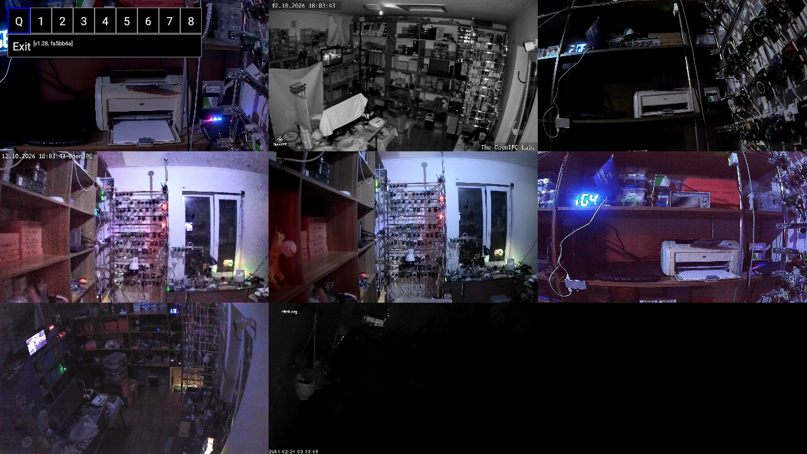
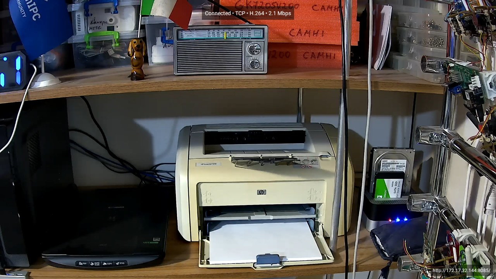
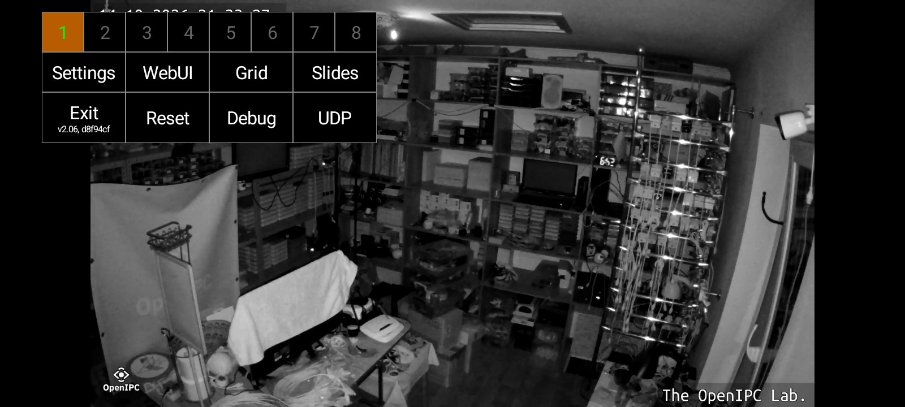
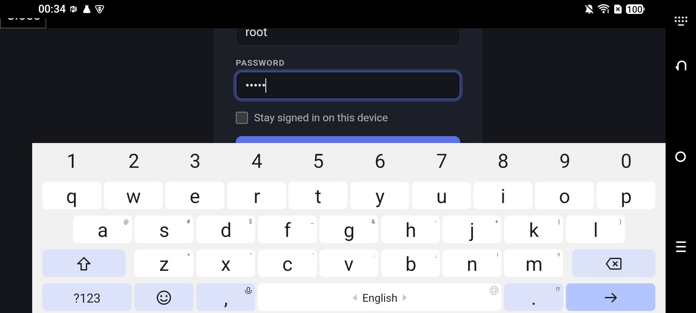
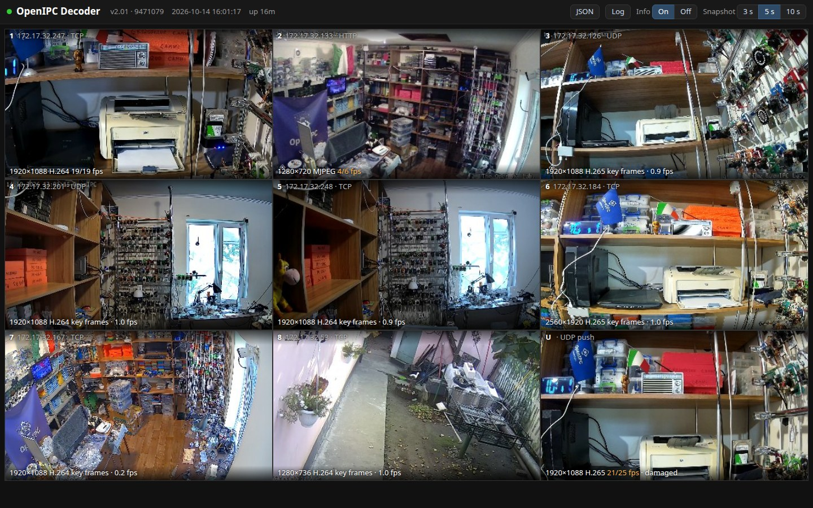
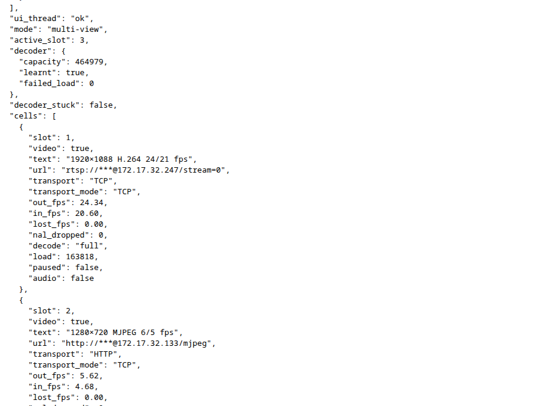
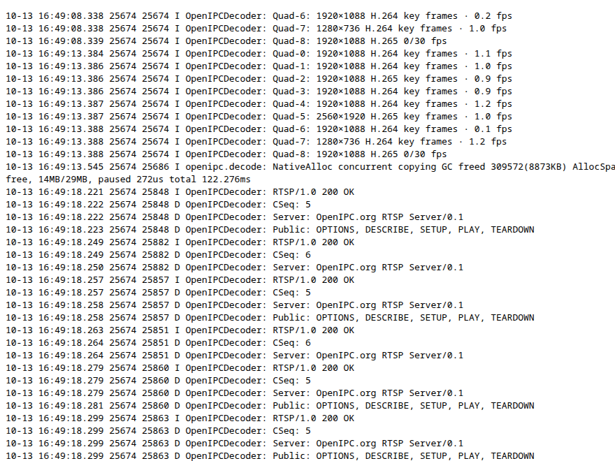

![OpenIPC logo][logo]

# OpenIPC Decoder

[English](README.md) | **Русский** | [简体中文](README.zh-CN.md)

[](https://github.com/OpenIPC/decoder/actions/workflows/build.yml)
[](https://github.com/OpenIPC/decoder/releases/latest)
[](LICENSE.md)
[](https://developer.android.com/about/versions/lollipop)

Компактное приложение для Android: показывает RTSP-потоки с IP-камер и декодирует H.264/H.265 аппаратно. Создано для камер с прошивкой [OpenIPC](https://openipc.org). Работает на телефонах, планшетах, телевизорах, ТВ-приставках и автомобильных устройствах.

- **Видео:** H.264/H.265 через MediaCodec, MJPEG по RTSP и HTTP; автоматическое восстановление декодера
- **Звук:** AAC, Opus, G.711, L16
- **Режимы:** одна камера или мультивид — до 8 камер и камера, которая сама шлёт RTP; декодирование подстраивается под возможности устройства
- **Сеть:** RTSP поверх TCP, UDP (Auto переходит на TCP) или multicast, RTP, который камера шлёт сама (Majestic `outgoing`), авторизация Basic и Digest, автоматическое переподключение
- **Прочее:** пульт Android TV, масштаб, веб-интерфейс камеры, адреса хранятся в зашифрованном виде, отладочная страница на порту 8085

<p align="center">
  
</p>

<p align="center">
  
</p>

<p align="center">
  
  
</p>

<p align="center">
  <br>
  
  
</p>

## Скачать

Готовые сборки лежат в единственном релизе [**latest**](https://github.com/OpenIPC/decoder/releases/latest) с заголовком `Decoder <версия>`. В именах файлов нет версии, поэтому эти ссылки не меняются:

| Файл             | Что это                           | Постоянная ссылка                                                            |
|------------------|-----------------------------------|------------------------------------------------------------------------------|
| `decoder-v2.apk` | **Текущая версия**, рекомендуется | <https://github.com/OpenIPC/decoder/releases/latest/download/decoder-v2.apk> |
| `decoder.apk`    | Старая версия из ветки `basic`    | <https://github.com/OpenIPC/decoder/releases/latest/download/decoder.apk>    |

Каждая новая сборка заменяет предыдущую в `latest`. Разработка идёт непрерывно, поэтому отдельных релизов по версиям нет; каждая новая версия ветки `v2` с коммитом публикуется файлом APK в Telegram-канале OpenIPC ([наши каналы](https://openipc.org/our-channels)).

История изменений по версиям — в [CHANGELOG.md](CHANGELOG.md).

Есть бета-канал в [Google Play](https://play.google.com/apps/internaltest/4701231141824898735). Чтобы попасть в него, пришлите свой e-mail через [Telegram-каналы OpenIPC](https://openipc.org/our-channels).

## Требования

- Android 5.0 (API 21) или новее
- IP-камера с RTSP или HTTP MJPEG либо камера, которая сама отправляет RTP по UDP (OpenIPC Majestic `outgoing`)
- Сервисы Google (GAPPS) **не** нужны. Для WebUI нужен рабочий системный WebView ([#15](https://github.com/OpenIPC/decoder/issues/15))

## Быстрый старт

1. Установите APK из [релиза latest](https://github.com/OpenIPC/decoder/releases/latest) и запустите приложение.
2. Коснитесь экрана или нажмите **OK** на пульте, чтобы открыть меню.
3. Выберите номер камеры (**1**–**8**), нажмите **Settings** и введите адрес камеры:
   ```
   rtsp://username:password@ip_address:554/stream=0
   ```
   Под адресом можно выбрать транспорт; у нового слота по умолчанию Auto (UDP с откатом на TCP). Ниже настройка **Turn** поворачивает картинку камеры, установленной боком или вверх ногами, а **Mirror** отражает её слева направо. Другие виды адресов — в [Transports](docs/transports.md) (на английском).
4. Нажмите **Save**. Приложение сразу подключится и само переподключится, если поток прервётся.

## Управление

```
[ 1 | 2 | 3 | 4 | 5 | 6 | 7 | 8 ]
[ Settings | WebUI  | Grid   | Slides ]
[ Exit     | Reset  | Debug  | UDP    ]
```

| Действие                    | Результат                                                          |
|-----------------------------|--------------------------------------------------------------------|
| Касание / **OK**            | Открыть или закрыть меню                                           |
| **1**–**8**                 | Слот камеры; цвет номера показывает качество связи                 |
| **Grid** / **Slides**       | Мультивид или одна камера / все кадры или только ключевые          |
| **Debug** / **UDP**         | Текст в ячейках мультивида / камера, которая шлёт RTP на порт 5600 |
| Два пальца, двойное касание | Масштаб и перемещение, сброс масштаба (одиночный режим)            |
| Долгое нажатие              | Скриншот (одиночный режим) / звук этой ячейки (мультивид)          |

Все пункты меню, пульт, передача адреса из другого приложения и **Reset** — в [Usage](docs/usage.md) (на английском).

## Запуск при включении

Приставка, которая только показывает камеры, может открывать приложение сама после включения. Сначала используйте автозапуск самого устройства, если он есть в его списке приложений (кнопка Menu на плитке Decoder → **AUTORUN**). Если его нет — включите **Start on boot** в **Settings**; на Android 10 и новее нужно ещё разрешение показывать окна поверх других приложений, приложение подскажет, как его дать. Подробно: [Start on boot](docs/usage.md#start-on-boot) (на английском).

## Известные ограничения

> [!IMPORTANT]
> На каждый пункт заведён issue — комментарии, результаты проверок и pull request приветствуются.
>
> - **RTSP multicast требует Android 8.0+** и сервера, который его поддерживает; камеры OpenIPC его не поддерживают — [#69](https://github.com/OpenIPC/decoder/issues/69)
> - **Не поддерживаются звук G.726 и MP4A-LATM с конфигурацией внутри потока (`cpresent=1`).** OpenIPC Majestic их не использует, а камеры с G.726 обычно умеют отдавать G.711 или AAC — [#14](https://github.com/OpenIPC/decoder/issues/14)
> - **MJPEG декодируется программно на устройствах без рабочего JPEG-декодера** (AG-216 его объявляет, но создать не может) — [#132](https://github.com/OpenIPC/decoder/issues/132)
> - **Видеодекодер AG-216 может перестать отвечать до перезагрузки устройства**: кадры приходят, но ни один не декодируется; приложение сообщает об этом на экране и на отладочной странице — [#145](https://github.com/OpenIPC/decoder/issues/145)
> - **Логин и пароль передаются в открытом виде** по RTSP/HTTP без шифрования (Basic, если камера не запросила Digest); RTSPS не поддерживается и не планируется — [#16](https://github.com/OpenIPC/decoder/issues/16)
> - **Скриншоты и снимок отладочной страницы требуют Android 7.0+**
>
> Известные ошибки собраны отдельно, под [меткой `bug`](https://github.com/OpenIPC/decoder/issues?q=is%3Aissue+is%3Aopen+label%3Abug).

## Документация

Документация написана на английском языке; ссылки ведут на английские документы.

| Документ                                | Содержание                                                                                                                                                |
|-----------------------------------------|-----------------------------------------------------------------------------------------------------------------------------------------------------------|
| [Usage](docs/usage.md)                  | меню, жесты и клавиши, пульт, мультивид, Slides, ячейка U, WebUI, передача адреса из другого приложения, скриншоты, Reset                                 |
| [Transports](docs/transports.md)        | форматы адресов и параметры: RTSP поверх TCP/UDP/Auto/multicast, приём `udp://` (Majestic `outgoing`), HTTP MJPEG; кодеки, авторизация, что умеют серверы |
| [Debug](docs/debug.md)                  | отладочная страница на порту 8085, описание полей `/stats.json`, `/log`, снимки, что приложить к сообщению об ошибке                                      |
| [Architecture](docs/architecture.md)    | путь данных, классы, потоки, планировщик декодирования, вывод через SurfaceView, структура репозитория                                                    |
| [Testing and releases](docs/testing.md) | ветки, CI, юнит-тесты, версии и релизы, сборки веток, `mapping.txt`, локальная сборка                                                                     |
| [Security](docs/security.md)            | хранилище учётных данных, отладочный сервер (только локальная сеть), скрытие паролей в логах, отсутствие шифрования в сети                                |
| [Devices](docs/devices.md)              | проверенные и неработающие устройства, особенности аппаратных декодеров, отчёты об устройствах и камерах                                                  |
| [Drones and Wi‑Fi toys](docs/toys.md)   | как передают видео игрушки, дроны FLOW-UFO, KY UFO и Jieli, что попробовать с неизвестной игрушкой, что прислать                                          |

История изменений — это [принятые pull request'ы](https://github.com/OpenIPC/decoder/pulls?q=is%3Apr+is%3Amerged+base%3Av2) и [коммиты ветки v2](https://github.com/OpenIPC/decoder/commits/v2).

## Поддержка

- Вопросы и сообщения об ошибках: [GitHub Issues](https://github.com/OpenIPC/decoder/issues)
- Проверили приложение на устройстве или камере? Пришлите [отчёт об устройстве](https://github.com/OpenIPC/decoder/issues/new?template=device_report.yml) или [отчёт о камере](https://github.com/OpenIPC/decoder/issues/new?template=camera_report.yml)
- OpenIPC: [openipc.org](https://openipc.org)

[](https://openipc.org/our-channels)

## Лицензия

[The Prosperity Public License 3.0.0](LICENSE.md): бесплатно для некоммерческого использования; для коммерческого — пробный период 30 дней. Полный текст — в [LICENSE.md](LICENSE.md).

[logo]: https://raw.githubusercontent.com/OpenIPC/.github/refs/heads/main/assets/openipc-logo-black.svg
