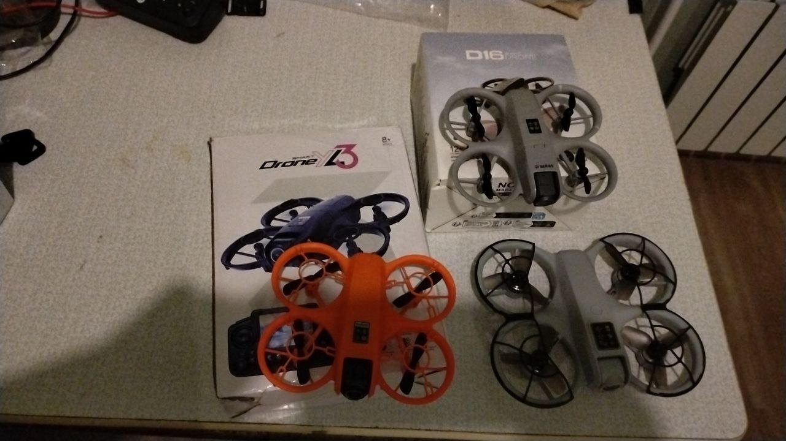

# Drones and Wi‑Fi toys

- [How such toys stream](#how-such-toys-stream)
- [Connecting](#connecting)
- [FLOW-UFO](#flow-ufo)
- [An unknown toy](#an-unknown-toy)
- [What to send in a report](#what-to-send-in-a-report)
- [Tested toys](#tested-toys)

## How such toys stream

Cheap drones, cars and other toys with a Wi‑Fi camera usually work the same way:

```
  toy (access point, e.g. 192.168.169.1)  ◄── Wi‑Fi, no internet ──►  phone (DHCP address from the toy)
        │                                                                 │
        └── video to the client that asked for it, vendor protocol ◄──────┘ the vendor app (or this app)
```

- The toy is its own **access point** with a fixed name (often the chip or product family plus a few hex digits) and a fixed address. The phone joins it and gets an address from the toy.
- There is **no internet** on that network.
- The video is often **not a standard stream**: no RTSP, no plain RTP. Many toys send JPEG frames over UDP in their own framing and start only after the client has sent a request; some also expect regular replies while they stream. A standard player then sees nothing, and this app stays in *Buffering*.
- Flight or drive commands go over the same network. **This app never sends any**: it only asks for and receives video.

Whether a toy can be played here depends on its protocol. Toys that do offer RTSP or HTTP MJPEG play like any camera ([transports.md](transports.md)); others need a transport of their own, like [FLOW-UFO](#flow-ufo).

## Connecting

1. Switch the toy on and join its Wi‑Fi on the phone.
2. Android notices that the network has no internet and may ask *This network has no internet access. Stay connected?* Answer **yes** (and *Don't ask again*). Otherwise the phone may drop back to another Wi‑Fi or route traffic over mobile data.
3. Mobile data may stay on, but some phones then send traffic for the toy's address over mobile data; if nothing arrives, try with mobile data off.
4. Close the vendor app: the toy usually streams to one client only.
5. While the phone is only on the toy's network, open the [debug pages](debug.md) on the phone itself: `http://127.0.0.1:8085/stats.json` and `http://127.0.0.1:8085/log`.

## FLOW-UFO

| | |
|---|---|
| Wi‑Fi name | `FLOW-UFO-xxxxxx` |
| Camera | BL60x Wi‑Fi camera module |
| Toy address | `192.168.169.1`, UDP port 8800 |
| Slot URL | `flowufo://192.168.169.1:8800` (or `flowufo://` alone) |
| Status | **in testing**, not in the releases: issue [#187](https://github.com/OpenIPC/decoder/issues/187), PR [#188](https://github.com/OpenIPC/decoder/pull/188) |
| Test build | [flowufo-187-test1](https://github.com/OpenIPC/decoder/releases/tag/flowufo-187-test1) (2.10 with the FLOW-UFO transport; installs over the release and keeps the settings) |

What the toy does, as far as is known:

- It sends nothing until a client sends it a short **probe** on UDP port 8800. The app repeats the probe until video arrives, and starts probing again when the toy goes quiet for 3 s.
- The video is **MJPEG**: each frame is cut into fragments of about 1 KB. The fragments carry the compressed picture without JPEG headers; the app adds standard headers and shows the frames through its normal MJPEG path.
- The client **acknowledges** regularly which fragments it has, and can ask for a frame again. The app does this; whether the toy really needs it is one of the open questions of the test.
- Video only, no sound. No flight command is ever sent.

The implementation was written from a description of the protocol, not tested on a real toy yet. Status texts while it connects: *Waiting for the toy: probing 192.168.169.1:8800*, *Receiving from the toy at …*, *The toy went quiet: probing … again*. The test build adds a `flowufo` object to `/stats.json` (state, network, frame and fragment counters, losses, resets, errors).

To test: install the test build, join the `FLOW-UFO-…` Wi‑Fi, [stay connected](#connecting), put `flowufo://192.168.169.1:8800` into a slot (**Settings**, or share the text to the app). If there is no picture, or it looks wrong, wait about 30 s and [send a report](#what-to-send-in-a-report) in [#187](https://github.com/OpenIPC/decoder/issues/187).

## An unknown toy

First find the toy's address: on Android it is usually the gateway of the Wi‑Fi (*Wi‑Fi → the network → Details*; often `192.168.0.1`, `192.168.1.1`, `192.168.4.1`, `192.168.169.1`, `172.16.10.1` or `192.168.25.1`). Then try, in a slot:

| Try | Why |
|---|---|
| `rtsp://<toy>:554/` | some toys run a plain RTSP server; try the paths `/live`, `/stream`, `/11`, `/h264` too |
| `rtsp://<toy>:8554/` | another common RTSP port |
| `http://<toy>:8080/?action=stream` | MJPEG streamers (mjpg-streamer style) |
| `http://<toy>/` and `http://<toy>:81/stream` | MJPEG on the web port; open them in a browser first to see what answers |
| `udp://@:<port>` | only if the toy pushes RTP by itself to a port of the phone, which is rare |

If nothing plays, the toy most likely uses a protocol of its own, which needs a [report](#what-to-send-in-a-report) and a transport written for it.

## What to send in a report

Open an [issue](https://github.com/OpenIPC/decoder/issues) (one per toy model) with:

1. The **Wi‑Fi name** of the toy (the part before the varying digits is enough) and the toy's make and model, with a photo of the box or label if possible.
2. The **vendor app**: its name, version and where it comes from (Google Play link).
3. The phone model and Android version, the app version and hash (menu, under **Exit**).
4. What you tried and what the app showed.
5. `http://127.0.0.1:8085/stats.json` and `http://127.0.0.1:8085/log`, taken on the phone after about 30 s of trying.
6. A **traffic capture** while the vendor app shows video: for example with [PCAPdroid](https://github.com/emanuele-f/PCAPdroid) on the phone (no root needed), filtered to the vendor app, saved as a `.pcap` file. A minute is enough. This shows what the toy expects and sends.

Do not send the vendor app itself or parts of it. The capture contains only the traffic between the phone and the toy; it has no passwords of yours if only the vendor app is captured.

## Tested toys

<p align="center">
  
</p>

The drones a tester checked in [#187](https://github.com/OpenIPC/decoder/issues/187) (photo by the tester):

| Toy | Wi‑Fi | Family | URL | Status |
|---|---|---|---|---|
| D16 (grey, on its box) | `FLOW_…` | FLOW-UFO, WIFI UAV app | `flowufo://192.168.169.1:8800` | video works |
| K200 | `FLY-UFO-…` | KY UFO, RTSP | `rtsp://192.168.1.1:7070/webcam` | video works; the picture comes sideways ([#200](https://github.com/OpenIPC/decoder/issues/200)) |
| Drone YL3 (box with a screen remote) | `HF_…` | Jieli AC79, DVRunning 2 app | `jieli://192.168.80.1` (test build) | in testing |

Which of the orange and the grey drone with black guards is the K200 and which is the YL3 will be added when the tester confirms.
